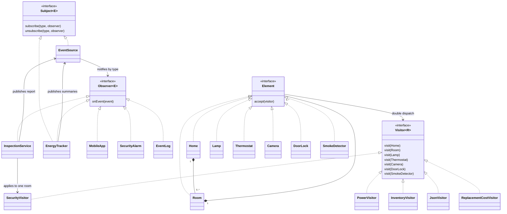

# Assignment 6 - Smart Home

Variant 7. Java 17 and JUnit 5; no runtime dependencies.

## Run

```sh
mvn clean verify
java -cp target/classes home.Demo
java -cp target/classes home.Demo 4
```

The optional argument controls the ExecutorService worker count (default 3).
The demo runs three producers: two energy samplers and one motion sensor.

## Project structure

```text
src/main/java/home/
  Demo.java       - composition root
  model/          - home, rooms and device records
  observer/       - event types, subjects and observer interfaces
  service/        - five event listeners and integration
  visitor/        - visitor interface and five operations
  concurrency/    - producer executor
src/test/java/home/visitor/
  HomeTest.java
  ReplacementCostTest.java
  SmokeDetectorTest.java
```

The trade-off commit file lists below use their original paths, before the package reorganization.

## Design decisions

### Observer

`Subject<E>` and `Observer<E>` are our generic interfaces. `HomeEvent` is an immutable record with an `EventType`. `EventSource` implements typed subscriptions. The composition root (`Demo.main`) creates every dependency and wires two sources (`devices`, `motion`) to five listeners: MobileApp, EnergyTracker, SecurityAlarm, EventLog and InspectionService. EnergyTracker is also a subject; its cumulative room energy events form a second notification stage.

Push is used: each handler receives the complete event, avoiding a race between a notification and a later read from a mutable source. DEVICE_STATE values are incremental Wh samples, not instantaneous watts. The immutable device tree is the configured inspection snapshot; the sample does not pretend to synchronize a real home or hardware.

The registry is an eagerly built EnumMap of CopyOnWriteArraySets. There is no whole-subject lock and no callback runs under a registry lock. Delivery iterates a snapshot. Adding a listener during delivery affects later snapshots; removing one does not cancel callbacks already captured by concurrent publishers. Duplicate subscriptions are ignored. A failing listener does not skip other listeners: all callbacks in that snapshot are attempted, then a combined exception is thrown to the producer.

Energy totals use ConcurrentHashMap.merge per room; mobile state uses ConcurrentHashMap, the log uses ConcurrentLinkedQueue and alarm counters use AtomicInteger. Concurrent notifications can arrive out of order; no global ordering is promised. Read final totals after producers finish. EventLog is an in-memory demo log, not durable storage.

### Visitor and Composite

`Home -> Room -> device` gives three levels and two container types. The original leaves are Lamp, Thermostat, Camera and DoorLock. Records validate inputs and defensively copy child lists. Elements contain data and the dispatch method only.

`accept(Visitor<R>)` calls `visitor.visit(this)` in each concrete record. For a DoorLock referenced as Element, runtime dispatch selects DoorLock.accept, then its statically typed `this` selects visit(DoorLock). Calling visit on an Element reference cannot select the correct overload by runtime type alone.

Visitors own traversal: Home and Room visits explicitly recurse through children. This supports subtree inspection and correct nested JSON without putting operations into the data records.

| Visitor | Result |
| --- | --- |
| PowerVisitor | Numeric current power in watts; inactive lamps/cameras use zero |
| InventoryVisitor | Stateful counts across the complete traversal; use a fresh instance for each report |
| SecurityVisitor | Immutable list of cameras not recording and unlocked doors |
| JsonVisitor | Hand-written nested JSON with escaped strings and device-specific fields |

Visitors are created per operation; InventoryVisitor is intentionally not shared between producer threads. Stateless visitors and immutable elements need no additional locking.

### Integration

Positive MOTION -> InspectionService looks up the event's Room -> SecurityVisitor visits that room only -> INSPECTION_REPORT is published -> EventLog records it. Reports do not feed back into motion, so the chain cannot recurse indefinitely. Unknown room names fail explicitly.

### Concurrency and shutdown

ProducerRunner uses a configurable fixed ExecutorService. The demo submits three producer tasks (default three workers); the stress test synchronizes four workers before each sends 1,000 events. Publishing is synchronous, so completing a task also completes its downstream notifications. invokeAll waits for all submitted tasks, Future.get propagates failures, shutdown plus awaitTermination drains normal work and leaves no worker running. External interruption is cancellation: shutdownNow is requested and interruption is propagated; the no-loss guarantee applies to normal completion, not forcibly cancelled work. Handlers must terminate and producers must cooperate with interruption.

## Hand-checked results

Demo: living room = 12 + 1000 + 0 + 1 = 1013 W; bedroom = 0 + 1 = 1 W; total = 1014 W. Inventory: 2 lamps, 1 thermostat, 1 camera, 2 locks. Security findings: Indoor and Front door. The samplers produce 200 Wh and 100 Wh; motion creates 100 alerts and 100 room inspection reports. Log: 200 samples + 200 summaries + 100 motion events + 100 reports = 600.

The smaller JUnit fixture uses 10 + 100 + 0 + 1 = 111 W and two security findings. The stress test asserts exactly 4,000 source notifications, 4,000 aggregate notifications and 4,000 Wh. Tests also cover snapshot semantics, self-unsubscription, subscription inside callbacks, listener failures, immutable collections, JSON nesting/escaping, subtree isolation, invalid data and producer failure propagation.

## UML class diagram



## Clean Code

Only Demo.main composes the running application. Dependencies are supplied through constructors, fields are initialized eagerly, and no service locators or lazy singletons are used. Each listener and visitor has one operation to own. No Observable, event-bus library, UI, database or network service is required.

## Trade-off proof: new visitor

Commit `Add replacement cost visitor without changing elements` changes exactly:

- `src/main/java/home/ReplacementCostVisitor.java`
- `src/test/java/home/ReplacementCostTest.java`
- `README.md`

No element class or Visitor interface changes. The operation estimates a replacement budget using fixed demo prices: lamp 20, thermostat 150, camera 80, lock 60 units. The fixture total is 310. This is Visitor's advantage when operations change more frequently than element types. The cost is one method for each existing type in the new visitor.

## Trade-off proof: new element

Commit `Add smoke detector and update every visitor` changes exactly:

- `src/main/java/home/SmokeDetector.java`
- `src/main/java/home/Visitor.java`
- `src/main/java/home/PowerVisitor.java`
- `src/main/java/home/InventoryVisitor.java`
- `src/main/java/home/SecurityVisitor.java`
- `src/main/java/home/JsonVisitor.java`
- `src/main/java/home/ReplacementCostVisitor.java`
- `src/test/java/home/SmokeDetectorTest.java`
- `README.md`

The fifth leaf adds `visit(SmokeDetector)` to the generic visitor contract and all five visitors. Existing Home, Room and the four original leaves remain unchanged. A smoke detector always consumes its configured watts; unhealthy detectors become security findings; replacement cost is 35 units. The test inserts the new leaf under Home -> Room and exercises every operation.

This is Visitor's cost: adding an element requires changing every operation. For a device schema that changes frequently with few operations, ordinary polymorphism or a different model would be simpler. These commits were made at implementation time; the repository does not claim two weeks of development history.
